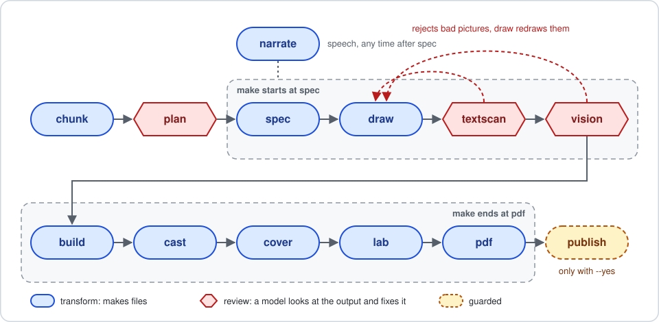

# Sutur (سطور)

**Arabic novels you can see before you read them.**

Sutur turns Arabic books into manga-style pages: black-and-white ink art, with the original diacritized text beside the pictures. Live at **[sutur.ink](https://sutur.ink)**.

> This repository is just getting started. We're opening Sutur up so the people who care about Arabic books, manga, and AI drawing can follow along, share what works, and help with what doesn't.

## The pipeline

[`pipeline/`](pipeline/) is the drawing pipeline as code: one task per stage, run per volume on a GPU box. Python 3.12 and Pillow, tests that need no GPU.

Start with [pipeline/README.md](pipeline/README.md). Publishing to the site is deliberately guarded: it only runs with `--yes`, after you have looked at the review sheets.

## Apps

[`apps/desktop/`](apps/desktop/) is the Mac app: the reading app in its own window. Builds are on the [Releases](https://github.com/fr3on/sutur/releases) page.

## What we're building

- **A reader** for Arabic books: right-to-left, diacritics on or off, notes beside the pages, PDF and EPUB downloads, send to Kindle.
- **A drawing pipeline** that turns a long novel into scenes, a character bible, and manga pages, using image models that run on our own hardware.
- **A library** of coming-soon and published books, with author pages, portraits and covers.

## How it works, in short

1. A book's text is cleaned and split into scenes.
2. A character bible and a storyboard say what each picture shows.
3. An image model draws the pictures only.
4. **The Arabic lettering is set by code in a real font**, never drawn by the model, because image models misspell Arabic.
5. The original text stays word for word, shown beside the pictures.

Read the full promises in the [manifesto](MANIFESTO.md), and see why drawing Egyptians across historical periods is hard in [MODEL.md](MODEL.md).

## The lab challenges (what we'll write about)

We're sharing what we learn as we go. A few topics coming:

- Keeping a character's face the same across hundreds of panels
- Getting Arabic lettering exactly right, joined and right to left
- Period and cultural drift in AI art (wrong clothes, wrong buildings, wrong props) and how we catch it
- Drawing at scale on one GPU without wasting it

If one of these is your problem too, open an issue and tell us how you solved it.

## Status

Early and moving fast. Not everything is in this repo yet; code and tools will land here step by step. Nothing here contains keys, passwords, or user data, and it never will.

## Licensing

- **Code:** [MIT](LICENSE).
- **Art and layouts made by Sutur:** CC BY 4.0. Use them, adapt them, and say where they came from.
- **Book texts:** each book keeps its own source and licence. Our texts come from [Hindawi](https://www.hindawi.org) (safahat.org) under CC BY 4.0. Credit the author, the source and the licence when you reuse them.
- Author portraits are illustrations, not photographs.

## Get involved

- Try the site: [sutur.ink](https://sutur.ink)
- Tell us which book you'd like drawn next
- Open an issue for bugs, wrong Arabic, or art that looks off

Made with care for Arabic stories.
